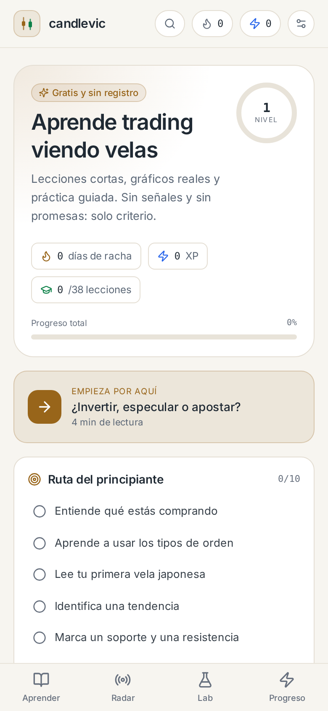
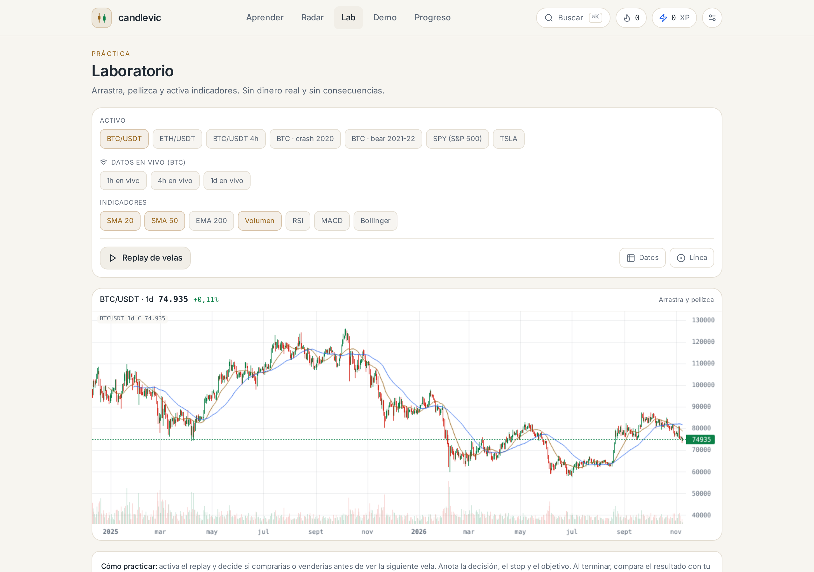
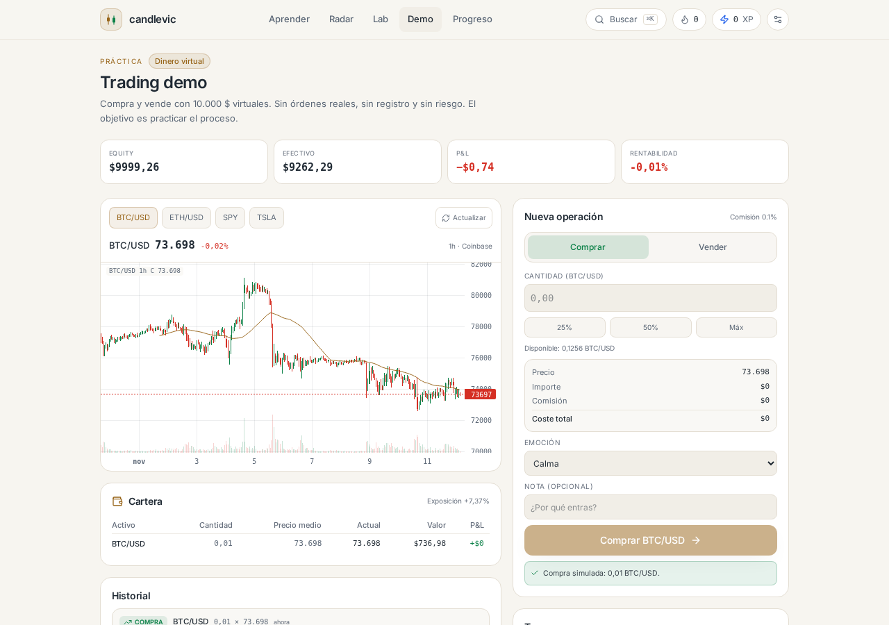

# Candlevic

**Aprende trading viendo velas.**

Web app educativa, gratuita y mobile-first para aprender trading de acciones y cripto: lecciones cortas, gráficos interactivos, quizzes, laboratorio de práctica y un radar de noticias con contexto.

> Candlevic es contenido educativo. No es asesoramiento financiero, no da señales y no promete rentabilidad.

| Móvil | Laboratorio | Demo |
| --- | --- | --- |
|  |  |  |


## Qué incluye

- **38 lecciones** repartidas en 10 módulos: mentalidad, fundamentos, estilos, gráficos, tendencia, indicadores, riesgo, estrategia, **psicología del trading** y cripto práctico.
- **8 estrategias de trading** con reglas, contexto, errores, quiz y backtest: tendencia, ruptura, reversión, rango, DCA y carry.
- **Cuatro temas** (Noche, Grafito, Papel y Sepia) con detección del sistema, tipografía Inter y ajustes de lectura: tamaño, interlineado, ancho, modo concentración y fondo ambiente.
- **Buscador global (Ctrl+K)** en lecciones, glosario, libros, estudios, explicadores y páginas.
- **Índice de lección** en escritorio y hoja inferior en móvil, con seguimiento de la sección activa.
- **Repaso espaciado** a nivel de lección y **dominio por módulo**, con señal de confianza en los quizzes.
- **Quizzes con explicación de cada opción incorrecta**, no solo de la correcta.
- **Gráficos reales interactivos** con velas, medias móviles, RSI, MACD, Bollinger, volumen, marcadores y líneas de precio.
- **Ejercicios interactivos**: escenarios ramificados, plan de trading editable, calculadoras de liquidación y funding, y patrones esquemáticos.
- **Laboratorio**: indicadores (SMA, EMA, RSI, MACD, Bollinger), replay de velas, líneas horizontales y datos en vivo con respaldo Binance/Coinbase.
- **Radar**: titulares en español de cripto, bolsa y macro, calendario de eventos y explicadores permanentes.
- **Trading demo**: 10.000 $ virtuales, compras y ventas a mercado, cartera, P&L, historial con emoción y curva de equity.
- **Backtesting didáctico**: comprar y mantener, cruce de medias, Donchian, RSI, pullback, rango y DCA, con costes, drawdown y curvas de equity.
- **Accesibilidad**: tabla de datos OHLC, resumen textual de cada gráfico y modo daltónico con velas huecas.
- **Legal y confianza**: Sobre, Privacidad, Términos, Accesibilidad, Fuentes y atribuciones.
- **Analítica opcional** agregada y sin cookies (Umami); desactivada si no se configura.
- **E2E** de los flujos críticos con Playwright en CI.
- **Estudios**: 5 casos históricos (LUNA, COVID, FTX, GME, dotcom) y evidencia científica (Barber & Odean, SPIVA, Dalbar…).
- **Biblioteca**: fichas originales de 10 libros clave del trading.
- **Glosario** con buscador y categorías.
- **Test “¿Qué trader eres?”** con plan de 30 días.
- **Progreso local** con XP, racha y logros. Respaldo con un código de guardado: corto y cifrado si hay nube (Upstash), o autónomo y sin servidor si no la hay. Sin email ni contraseña.
- **PWA** instalable, con aviso offline, actualización de versión y atajos a Demo y Lab.

## Stack

- Next.js 16 (App Router) + React 19 + TypeScript
- Tailwind CSS v4
- Inter variable autoalojada (48 KB, subset latino)
- lightweight-charts (TradingView)
- Zustand para el progreso local
- MDX para el contenido
- Upstash Redis (opcional) para el respaldo cifrado
- Vitest para unit tests y Playwright para E2E

## Empezar en local

```bash
npm install
npm run dev
```

Abre `http://localhost:3000`.

### Variables de entorno (opcional)

El respaldo en la nube usa Upstash Redis. Sin estas variables la app funciona igual: el respaldo se desactiva y queda la exportación/importación de un archivo JSON.

```bash
cp .env.example .env.local
```

```env
UPSTASH_REDIS_REST_URL=
UPSTASH_REDIS_REST_TOKEN=
```

Analítica opcional (Umami, sin cookies). Si no se configura, no se carga ningún script:

```env
NEXT_PUBLIC_UMAMI_WEBSITE_ID=
NEXT_PUBLIC_UMAMI_SRC=
```

En desarrollo, si no hay Upstash, el respaldo se guarda en `.data/progress-backups.json` (ignorado por git).

## Scripts

```bash
npm run dev        # desarrollo
npm run build      # build de producción
npm run start      # servidor de producción
npm test           # tests unitarios
npm run test:e2e   # tests E2E (requiere build y servidor)
npm run typecheck  # TypeScript
node scripts/fetch-data.mjs   # refresca los datasets desde Binance y Yahoo
```

## Estructura

```
app/                  rutas y API
content/              lecciones, estudios, radar, biblioteca, glosario
components/           UI, gráficos, lecciones, laboratorio, progreso
lib/                  indicadores, datos, contenido, progreso, cifrado, noticias
data/                 datasets OHLCV incluidos
scripts/              descarga de datos y generación de iconos
```

## Añadir una lección

Crea un archivo en `content/lecciones/mi-leccion.mdx`:

```mdx
---
title: "Mi lección"
module: "m4"
order: 1
minutes: 4
level: "principiante"
summary: "Resumen de una frase."
objectives:
  - "Objetivo 1"
dataset: "btc-1d"
related: ["tendencia"]
tags: ["tendencia"]
---

Texto de la lección.

<Callout type="tip">Un consejo.</Callout>

<DatasetChart dataset="btc-1d" from={600} to={700} showVolume />

<Quiz
  question="¿Pregunta?"
  options={["A", "B", "C"]}
  correct={1}
  explanation="Por qué."
/>
```

El frontmatter se valida con Zod en el build: si falta un campo, el build falla con un mensaje claro.

> El MDX se compila con `blockJS: false` porque el contenido es propio y de confianza (usa props JSX como `from={600}` o `markers={[...]}`). No se renderiza MDX enviado por usuarios.

## Despliegue

Pensado para Vercel:

1. Importa el repositorio en Vercel.
2. Añade `UPSTASH_REDIS_REST_URL` y `UPSTASH_REDIS_REST_TOKEN` si quieres activar el respaldo.
3. Deploy.

También funciona en cualquier hosting que soporte Next.js.

## Privacidad y datos

- El progreso se guarda en el navegador (localStorage).
- El respaldo se cifra en el cliente con AES-GCM y una clave derivada del código mediante PBKDF2. El servidor solo almacena un blob cifrado y no puede leerlo.
- No hay cuentas ni email. La analítica es opcional, agregada y sin cookies.
- Las páginas de Privacidad, Términos, Accesibilidad y Fuentes explican el detalle.
- Las noticias enlazan siempre a la fuente original.

## Derechos de autor

Las fichas de libros y los resúmenes de estudios son originales y educativos. No reproducen texto de las obras citadas. Las noticias pertenecen a sus respectivos medios y se muestran solo como titular, extracto corto y enlace.

## Licencia

MIT. Ver [LICENSE](./LICENSE).
